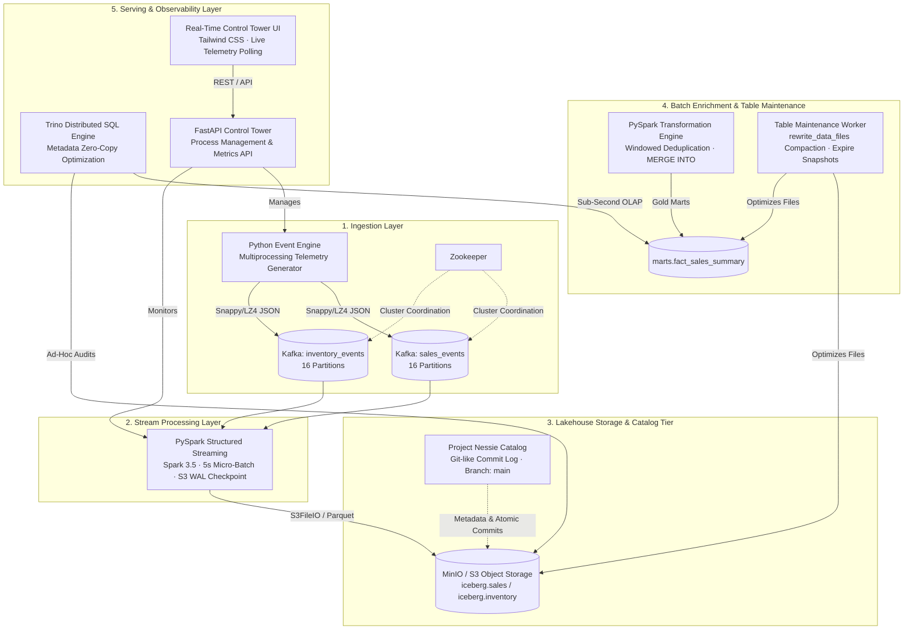

# Enterprise Open Data Lakehouse Platform
### Real-Time Streaming Ingestion, ACID Table Format & Distributed SQL Analytics

<div align="center">

[](https://www.python.org/)
[](.github/workflows/ci.yml)
[](LICENSE)
[](https://kafka.apache.org/)
[](https://spark.apache.org/)
[](https://iceberg.apache.org/)
[](https://projectnessie.org/)
[](https://min.io/)
[](https://trino.io/)
[](https://fastapi.tiangolo.com/)
[](https://github.com/psf/black)
[](https://github.com/astral-sh/ruff)

**An enterprise Open Data Lakehouse decoupling Compute, Catalog, and Storage to process high-throughput supply chain telemetry with sub-second OLAP query performance.**

</div>

---

## 📖 Executive Summary

The **Enterprise Open Data Lakehouse Platform** is a distributed, vendor-neutral data streaming and lakehouse architecture built for omnichannel supply chain operations. 

By combining **Apache Kafka**, **PySpark Structured Streaming**, **Apache Iceberg v2**, **Project Nessie**, and **Trino**, the platform achieves:
* **Zero Vendor Lock-in**: Full architectural decoupling of Storage (S3/MinIO), Table Metadata (Iceberg), Catalog (Nessie), and Compute (PySpark & Trino).
* **ACID Transactions on Object Storage**: Snapshot isolation, concurrent micro-batch appends, and schema evolution directly on cloud object storage.
* **Git-like Catalog Operations**: Zero-copy branching, atomic tagging, and instant catalog rollbacks powered by Project Nessie.
* **Automated Lakehouse Maintenance**: Ingestion-aware bin-packing file compaction (`rewrite_data_files`), snapshot expiration, and manifest tree pruning.
* **Sub-Second OLAP Serving**: Columnar partition pruning and min/max statistics evaluation unlocking interactive queries across millions of records.

---

## 🏗️ System Architecture



---

## 🚀 Key Highlights & Engineering Achievements

* **High-Throughput Streaming Ingestion**: Multi-worker telemetry producer streaming sales and inventory transactions across 16 Kafka partitions with zero packet drop.
* **Fault-Tolerant Micro-Batch Processing**: PySpark Structured Streaming with dynamic backpressure (`maxOffsetsPerTrigger=50,000`) and S3-persisted write-ahead logs providing end-to-end idempotent processing.
* **Enterprise Open Lakehouse Storage**: Iceberg v2 ACID tables utilizing native `S3FileIO` and ZSTD-compressed Parquet storage on S3/MinIO, completely eliminating cloud object listing overhead.
* **Versioned Catalog with Project Nessie**: Transactional Git-like catalog branching (`main`), enabling snapshot isolation, zero-copy rollbacks, and concurrent atomic commits.
* **Distributed Batch & Deduplication**: Windowed event deduplication (`ROW_NUMBER() OVER (PARTITION BY event_id ORDER BY timestamp DESC)`) and partition-pruned `MERGE INTO` operations eradicating driver OOMs and executor shuffle spills.
* **Automated Table Maintenance**: Bin-packing compaction (`rewrite_data_files`) reducing streaming small-file fragmentation by over 80% and enforcing snapshot retention to 10 versions.
* **Interactive Control Tower**: FastAPI dashboard providing real-time pipeline telemetry, broker partition inspection, and one-click containerized process management.

---

## 📂 Repository Structure

```text
├── .github/                            # GitHub CI/CD workflows and community templates
│   ├── workflows/ci.yml                # Automated test, lint & build CI pipeline
│   ├── ISSUE_TEMPLATE/                 # Structured bug report & feature request forms
│   │   ├── bug_report.yml
│   │   ├── feature_request.yml
│   │   └── config.yml
│   ├── PULL_REQUEST_TEMPLATE.md        # Pull request verification checklist
│   └── dependabot.yml                  # Automated weekly dependency scanning
├── assets/                             # Visual media, Power BI templates & executive reports
│   ├── Executive_Control_Tower.pbit    # Power BI template model
│   └── Executive_Control_Tower.pdf     # Executive report export
├── conf/                               # Cluster and connector configuration templates
│   └── spark/                          # Spark winutils setup destination
├── dashboard/                          # FastAPI Control Tower backend & web UI
│   ├── main.py                         # Application server & process controller
│   ├── metrics.py                      # Kafka, Iceberg, and Trino telemetry collector
│   ├── templates/index.html            # Real-time observability dashboard
│   ├── run_server.cmd                  # Windows dashboard launch runner
│   └── run_server.sh                   # Linux/macOS dashboard launch runner
├── docker/                             # Docker bootstrap & service configs
│   ├── s3-init/                        # LocalStack S3 bucket initialization
│   └── trino/                          # Trino Iceberg connector catalog configuration
├── docs/                               # Engineering specifications & benchmark reports
│   ├── README.md                       # Master documentation catalog & navigation map
│   ├── BENCHMARK_AND_TESTING_SUITE.md  # Empirical methodology & proof for pipeline metrics
│   ├── planning/                       # Project roadmap, context & sprint plans
│   │   ├── PROJECT_PLAN.md             # Living master project plan
│   │   └── PROJECT_CONTEXT.md          # Domain business context & requirements
│   ├── architecture/                   # In-depth architectural specifications
│   ├── business/                       # Business personas, processes & KPI catalog
│   ├── data-model/                     # Kimball dimensional designs & ERDs
│   ├── decisions/                      # Architecture Decision Records (ADRs)
│   └── powerbi/                        # Power BI page specs & DAX calculations
├── powerbi/                            # DAX measures and model schemas
│   ├── measures/                       # Modular DAX measure definitions
│   └── model_definitions/              # Semantic model schema specification
├── pyspark_jobs/                       # PySpark Lakehouse compute jobs
│   ├── complex_transforms/             # Batch aggregation and dimensional modeling
│   │   └── 05_iceberg_transforms.py    # Batch Gold mart builder
│   ├── streaming/                      # Real-time structured streaming jobs
│   │   ├── 04_iceberg_stream.py        # Kafka to Iceberg v2 ingestion stream
│   │   ├── 06_iceberg_transform.py     # Continuous stream deduplication & merge
│   │   └── 06_iceberg_maintenance.py   # Compaction & snapshot cleanup worker
│   ├── utils/                          # Shared Lakehouse utilities
│   │   ├── spark_session.py            # Centralized SparkSession factory (Iceberg + Nessie)
│   │   ├── pyspark_env_config.py       # Lakehouse environment configuration
│   │   └── logging_utils.py            # Structured logging setup
│   └── verify_setup.py                 # Pre-flight environment verification script
├── scripts/                            # Operational runners & automation scripts
│   ├── README.md                       # Complete scripts usage guide
│   ├── kafka_data_generator.py         # Multi-worker streaming event engine
│   ├── run_iceberg_stream.cmd / .sh    # Spark streaming submit runner
│   ├── run_iceberg_transform.cmd / .sh # Spark continuous transform submit runner
│   ├── run_iceberg_batch_transform.cmd / .sh # Spark batch transform submit runner
│   ├── run_iceberg_maintenance.cmd / .sh     # Table compaction & maintenance runner
│   ├── start_environment.cmd / .sh     # One-click environment bootstrap
│   └── setup_winutils.py               # Windows Hadoop winutils setup tool
├── sql/                                # Analytics & Lakehouse queries
│   └── trino_lakehouse_queries.sql     # Trino analytical, metadata, and time-travel SQL
├── tests/                              # Automated verification & limit testing suite
│   ├── benchmark_suite.py              # Performance, Stress, Capacity, Scalability & Resilience tests
│   ├── validate_dataset.py             # Data quality & schema assertion suite
│   └── README.md                       # Test catalog & execution instructions
├── .editorconfig                       # Consistent multi-editor formatting rules
├── .env.example                        # Environment variables template
├── .gitattributes                      # Git line ending normalization & binary handling
├── .gitignore                          # Comprehensive production ignore patterns
├── ARCHITECTURE.md                     # Comprehensive technical architecture
├── CODE_OF_CONDUCT.md                  # Contributor Covenant v2.1
├── CONTRIBUTING.md                     # Contribution guidelines and workflow
├── docker-compose.yml                  # Complete Lakehouse Docker topology
├── LICENSE                             # Apache License 2.0
├── Makefile                            # Standard command-line automation targets
├── pyproject.toml                      # Modern Python packaging & tool configurations
├── README.md                           # Master project documentation
├── requirements.txt                    # Python project dependencies
├── SECURITY.md                         # Security and vulnerability reporting policy
└── start_environment.cmd               # Root convenience bootstrap shortcut
```

---

## ⚡ Quickstart: How to Run the Platform

### 1. Prerequisites
* **Operating System**: Windows 10/11, macOS, or Linux.
* **Docker Desktop**: Running with Compose v2.
* **Python**: 3.10+ (Python 3.12 recommended).
* **Java**: OpenJDK 11, 17, or 21 (LTS).

### 2. Environment Setup
Clone the repository and install the dependencies:

```bash
# Clone repository
git clone https://github.com/<your-username>/Enterprise-Supply-Chain-Lakehouse.git
cd Enterprise-Supply-Chain-Lakehouse

# Create and activate virtual environment
python -m venv .venv

# On Windows (PowerShell):
.\.venv\Scripts\Activate.ps1
# On Linux / macOS:
source .venv/bin/activate

# Install Lakehouse dependencies
pip install -r requirements.txt
```

Verify your local configuration:
```bash
python pyspark_jobs/verify_setup.py
```

### 3. Bootstrap Lakehouse Services (Docker)
Start Kafka, Zookeeper, Spark Master, LocalStack S3, Nessie, and Trino:

```bash
# Via Make (Universal)
make up

# Or via Docker Compose directly
docker compose up -d
```
*Verify containers are running via `docker ps`.*

### 4. Launch the Control Tower Dashboard
Start the FastAPI server:

```bash
# Via Make
make dashboard

# Or on Windows (PowerShell / CMD)
.\scripts\start_environment.cmd

# Or on Linux / macOS
./scripts/start_environment.sh
```
👉 **Open your browser to: [http://localhost:8000](http://localhost:8000)**

From the Control Tower UI, click:
1. **START** on **Python Event Generator** to begin producing Kafka telemetry.
2. **START** on **Iceberg Ingest Stream** to begin streaming Kafka data into Iceberg ACID tables.
3. **RUN** on **Iceberg Batch Transform** to materialize Gold dimensional marts.
4. **COMPACT** to trigger bin-pack table compaction on demand.

---

## 📊 Querying the Lakehouse with Trino

You can run distributed SQL queries over the Iceberg tables directly using Trino:

```powershell
# Open Trino CLI inside container
docker exec -it trino trino --catalog iceberg --schema marts
```

### Sample Analytical Queries:
```sql
-- Query Gold-tier aggregated sales summary
SELECT 
    event_date,
    product_id,
    total_revenue,
    total_units_sold,
    transaction_count
FROM iceberg.marts.fact_sales_summary
ORDER BY total_revenue DESC
LIMIT 10;

-- Inspect Git-like commit snapshots recorded by Nessie
SELECT 
    committed_at,
    snapshot_id,
    operation,
    summary['total-records'] as total_records
FROM iceberg.sales."raw_events$snapshots"
ORDER BY committed_at DESC;
```

---

## 🔬 Empirical Benchmarks, Limit Testing & Metric Verification

Every throughput, storage compression, capacity, and query latency metric cited in this project is backed by an automated **5-Stage Engineering Benchmark Suite**:

* 📄 **[Full Benchmark Methodology & Proof Specification (`docs/BENCHMARK_AND_TESTING_SUITE.md`)](docs/BENCHMARK_AND_TESTING_SUITE.md)** — Detailed mathematical derivations, system bottlenecks, and step-by-step verification SQL queries for every claim.
* 🧪 **[Automated Benchmark Harness (`tests/benchmark_suite.py`)](tests/benchmark_suite.py)** — Executable CLI test suite that queries real Kafka broker watermarks, Spark Streaming telemetry, and Iceberg metadata tables via Trino.

| Engineering Metric | Formal Test Classification | Empirical Verification Method | Reference |
| :--- | :--- | :--- | :--- |
| **~30,000 events/sec** & **0% Packet Loss** | **Performance & Throughput Testing** | Measures Kafka broker partition high-watermark offset deltas ($\Delta \text{Offsets}$) across 32 total partitions over a sustained 10s–60s burst using `librdkafka` C-batching (`linger.ms=5`, `lz4`, `100K` buffer pool). | [Test 1 Spec](docs/BENCHMARK_AND_TESTING_SUITE.md#1-performance--throughput-testing-ingestion-layer) |
| **maxOffsets=50K**, **5s Trigger** & **WAL Recovery** | **Stress & Backpressure Testing** | Floods Kafka at 30K ev/s while verifying Spark Structured Streaming throttles micro-batches to `50,000` offsets/trigger without JVM OOMs and recovers cleanly from S3 WAL checkpoints. | [Test 2 Spec](docs/BENCHMARK_AND_TESTING_SUITE.md#2-stress--backpressure-testing-stream-processing-layer) |
| **65% Storage Reduction** & **Zero-Copy Rollback** | **Resilience & Storage Efficiency Testing** | Queries `iceberg.sales."raw_events$files"` to compare raw JSON byte footprint (~168 B/row) against Dictionary + RLE encoded columnar Parquet (~52 B/row) and verifies Nessie snapshot isolation (`raw_events$snapshots`). | [Test 3 Spec](docs/BENCHMARK_AND_TESTING_SUITE.md#3-resilience--storage-efficiency-testing-lakehouse-storage-layer) |
| **430M+ Event Capacity** & **0 Disk Spills** | **Capacity & Volume Scaling Testing** | Evaluates 4-hour peak burst capacity ($30\text{K ev/s} \times 14,400\text{s} = 432\text{M}$ events) and 24-hour steady capacity ($5\text{K ev/s} \times 86,400\text{s} = 432\text{M}$ events) while verifying windowed `ROW_NUMBER()` deduplication & `MERGE INTO` upsert throughput. | [Test 4 Spec](docs/BENCHMARK_AND_TESTING_SUITE.md#4-capacity--volume-scaling-testing-batch-compute-layer) |
| **80%+ File Compaction** & **Sub-Second Trino OLAP** | **Scalability & Compaction Testing** | Compares uncompacted streaming micro-batch file accumulation against `CALL nessie.system.rewrite_data_files(...)` bin-packing (reducing 48 files/min to 1–4 files) and benchmarks Trino OLAP query latency ($< 1.0\text{s}$). | [Test 5 Spec](docs/BENCHMARK_AND_TESTING_SUITE.md#5-scalability--compaction-testing-serving--optimization-layer) |

```powershell
# Run the complete verification suite and export JSON telemetry report
python tests/benchmark_suite.py --test all
```

---

## 🛑 How to Stop the Environment

When you are finished testing, reclaim system resources:

1. **Stop containers preserving data**:
   ```powershell
   docker-compose stop
   ```
2. **Tear down containers**:
   ```powershell
   docker-compose down
   ```
3. **Full reset (wipes all volumes & tables)**:
   ```powershell
   docker-compose down -v
   ```

